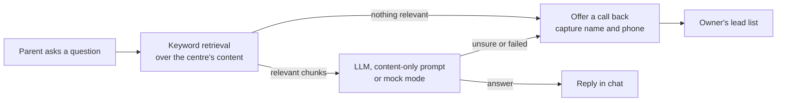

# Coaching FAQ Bot

[](https://github.com/rajuerladinny/coaching-faq-bot/actions/workflows/ci.yml)


An AI enquiry assistant for coaching and tuition centres. The owner pastes in
the centre's details; the bot answers parent and student questions from that
content only, and captures a name and phone number when it cannot answer.

**Status:** working prototype, not yet piloted with a real centre. See
[PLAN.md](PLAN.md) for the product plan, pricing and roadmap.

## What it does

For parents and students:

- A chat page per centre, answering only from what the owner wrote.
- One-tap questions built from the owner's topic labels ("Fees", "Timings").
- When the bot is unsure it does not guess: it offers a call back and takes a
  name and phone number.

For the owner:

- **Leads** with the questions each person asked, call and WhatsApp links,
  "contacted" tracking, filters and CSV export.
- **Insights**: questions asked this month, the share the bot answered, and the
  questions it could not answer, so the owner knows what to add.
- **Try your bot**: test a question against the saved content without it
  counting as a parent message.
- **Share**: copy the chat link, share it on WhatsApp, or embed the chat on
  the centre's website.

## Try the demo

The app has a demo mode that runs entirely in the browser with a sample
centre: no backend, login or LLM.

```bash
cd frontend
npm install
npm run dev          # then open http://localhost:5173/?demo
```

`npm run build:demo` produces a static site in `frontend/dist` that can be
hosted anywhere; the **Deploy demo** workflow publishes it to GitHub Pages.

## How it works



## Project layout

```
backend/   Python + FastAPI + SQLite
  app/retrieval.py   chunking, keyword search, topic labels
  app/chat.py        answer-or-fallback logic, monthly message cap, insights
  app/llm.py         OpenAI-compatible LLM client, plus a no-LLM mock mode
  app/store.py       SQLite storage
  app/auth.py        password hashing and login tokens
  app/ratelimit.py   per-visitor message limits
  app/manage.py      operator commands: create centres, reset logins
  app/main.py        HTTP routes
  tests/             pytest tests for the core logic and the HTTP routes
frontend/  React + Vite
  src/Admin.jsx      owner page: leads, content, insights, sharing
  src/ChatWidget.jsx parent/student chat page
  src/lib/           demo backend, lead helpers (unit tested with node --test)
```

## Run the backend

```bash
cd backend
python -m venv .venv && source .venv/bin/activate
pip install -r requirements.txt
uvicorn app.main:app --reload        # http://localhost:8000
```

It starts in mock mode, which needs no LLM: the bot replies with the best
matching piece of the centre's content. To use a real model, set the variables
shown in `backend/.env.example` (export them in your shell; the app does not
load `.env` files by itself).

## Run the frontend

```bash
cd frontend
npm install
npm run dev                          # http://localhost:5173
```

## Create a centre and its owner login

Centres are created from the command line, not the web app, so nobody can
sign themselves up yet:

```bash
cd backend
python -m app.manage create-centre "Bright Academy" owner@example.com
python -m app.manage list
python -m app.manage set-owner 1 owner@example.com   # reset a login
```

Then open `http://localhost:5173/#/admin`, log in with that email and
password, paste the centre's content and save. The page shows a chat link
(`#/chat/<id>`) to share with parents.

## Deploy

The `Dockerfile` builds the React app and serves it together with the API from
one container.

```bash
docker build -t coaching-faq-bot .
docker run -p 8000:8000 -v faqbot-data:/data \
  -e SECRET_KEY=<long random string> \
  -e LLM_PROVIDER=mock \
  coaching-faq-bot
```

- `SECRET_KEY` must be set and kept the same across restarts, or owners get
  logged out on every restart.
- The `/data` volume holds the SQLite database. Without a persistent volume,
  all centres and leads are lost when the container restarts.
- Serve it over HTTPS (most hosts do this for you). Logins sent over plain
  HTTP can be read in transit.
- Behind a reverse proxy or load balancer, set `TRUST_PROXY=1` so rate limits
  apply per visitor instead of to the proxy.
- To create a centre on the server:
  `docker exec -it <container> python -m app.manage create-centre "Name" email`

## Tests

```bash
cd backend && pip install -r requirements-dev.txt && python -m pytest -q
cd frontend && npm test
```

CI runs both on every push and pull request, builds the frontend (normal and
demo), builds the Docker image and checks that the container serves the API
and the app as an unprivileged user.

## Limits and safeguards

- Owners see and edit only their own centre.
- Each visitor gets 20 chat messages per 10 minutes (`CHAT_LIMIT`), 5 callback
  requests per hour, and 10 login attempts per 15 minutes.
- Each centre has a monthly message cap (`MONTHLY_MESSAGE_CAP`).
- Owner previews are limited to 30 per 10 minutes per centre and are never
  stored.
- API responses are sent with `Cache-Control: no-store`; the owner page
  refuses to render inside a frame, while the chat page can be embedded.
- The container runs as an unprivileged user and reports its health.

## Known gaps

- The React pages have no automated browser tests; only their helper
  modules are unit tested.
- Mock mode and the demo reply with the best matching piece of content, so a
  loosely related question can get a loosely related answer. A real model
  (`LLM_PROVIDER=openai`) is needed for precise answers.
- 10-digit phone numbers are assumed to be Indian (+91) for WhatsApp links.
- No "forgot password" flow; reset logins with `set-owner`.
- Rate limits live in memory, so they reset on restart and assume one server
  process.
- SQLite suits the first handful of centres. Plan a move to Postgres before
  running more than one server.
